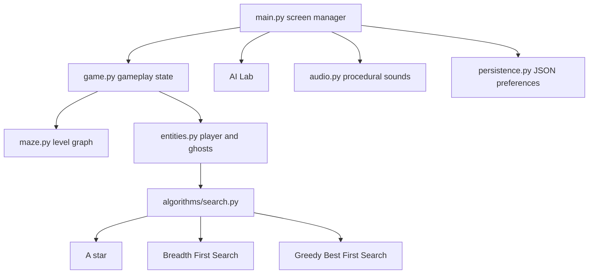

# GhostMind System Architecture

The game loop separates input, movement, target selection, pathfinding, collision resolution, sound events, and rendering. Search functions do not import Pygame, so automated tests can validate routes independently from the window.
